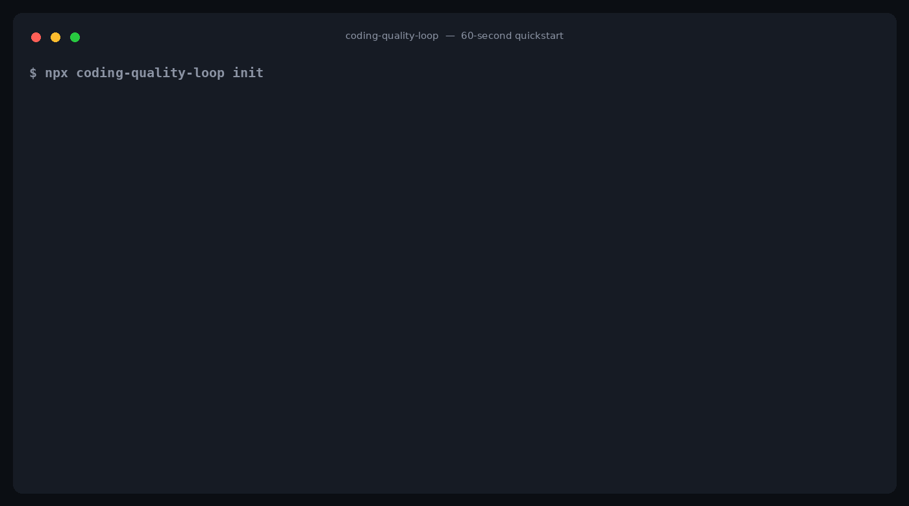

# Quickstart

Three ways to try the Coding Quality Loop, ordered by commitment. Pick the lightest one
that fits your task.

## Verify the record gate (10 seconds)

Before anything else, run the illustrative walkthrough record through the record gate. It exits 0:

```bash
python3 scripts/quality_loop.py verify-gates examples/walkthrough/agent-record.json
# verification gates look sufficient for recorded risk tier   (exit 0)
```

Green here means the example record satisfies the shape and policy checks in
`verify-gates`. The example has no invoice code or executable invoice tests, so this
command does not prove the described fix. On your own change, run `verify` and inspect
the test output, diff, and reviewer findings.

<div align="center">

</div>

## A. No install — drop-in prompt

Copy this into your agent's system prompt, project instructions, or the top of your
`CLAUDE.md` / `AGENTS.md` / `.cursor/rules`:

```text
Follow the Coding Quality Loop for this task.

1. Write a task contract: goal, acceptance criteria, constraints, risk tier.
2. Map only the files, callers, and tests relevant to the change. Not the whole tree.
3. Pick the smallest safe rung; briefly say what larger rungs you rejected and why.
4. Plan the diff, the verification commands, and the rollback.
5. Implement the smallest reviewable slice. No new dependencies unless the contract asks for it.
6. Verify: run the checks, record the exact commands and outputs. Prefer a failing-then-passing test.
7. Independent review: a distinct reviewer, fresh context, checks the diff against the contract.
8. Ship: a completion record with evidence table, risk note, rollback line.

Ship the smallest correct change with verifiable evidence, not the biggest possible diff.
```

Then prompt: *"Use the Coding Quality Loop to fix the invoice rounding bug and open a PR."*

This works in **every** agent host that accepts a system prompt. No files to copy, no
scripts to run, nothing to install.

## B. One-command install — `npx`

One command. Auto-detects your host (Claude Code, Codex, or Droid), copies the skill,
wires the hooks, and writes an install manifest so later `check` and `remove` are exact.

```bash
npx coding-quality-loop init
```

Shipped on [npm](https://www.npmjs.com/package/coding-quality-loop) with signed
provenance. Requires Node 18+ and Python 3.10+; zero runtime dependencies. Interactive by
default:

```bash
npx coding-quality-loop init --dry-run --yes   # preview only
npx coding-quality-loop init --host codex      # skip host detection
npx coding-quality-loop add git                # add the pre-commit backstop later
npx coding-quality-loop check                  # verify a prior install against its manifest
npx coding-quality-loop remove                 # use the manifest; restore verified installer backups
```

If `init` or `remove` refuses a legacy v1 manifest or an older v2 backup, preserve the manifest, files, hooks, and backups. Reconcile ownership on a separate copy; do not rename/delete the manifest, trust a `.bak` filename as ownership proof, or overwrite/retry to bypass the refusal. Stop if ownership cannot be established. Keep other processes from changing the target during install or removal; see the [npm installer notes](../packages/npm/README.md) for the concurrent-mutation limit.

The npx installer is a thin UX wrapper around
[`scripts/install.py`](../scripts/install.py); both full installer entry points
install the runtime files and host wiring. The manual skill copy below is
instruction-only. The npm tarball does **not** ship `evals/` or the control-plane
module — those live in the repo checkout (control is an opt-in add-on:
`python3 scripts/install.py --with-control-plane`).

After install, commit the install, then three commands that each exit 0 on a fresh setup:

```bash
git add -A && git commit -m "chore: install coding-quality-loop"    # 0. commit the install so the diff gates see a clean base
cp assets/quality-loop.config.example.json quality-loop.config.json  # 1. create the root config
python3 scripts/quality_loop.py setup-models --host claude-code      # 2. apply per-role model routing
claude "Use coding-quality-loop to fix a small bug"                  # 3. try it
```

The relocatable example omits `$schema` because its relative path changes when
copied to the project root. Run `python3 scripts/quality_loop.py check-config`
to check the installed config; the repo's own root config points to the schema.

## C. Manual copy — per host

Copy the skill bundle from a separate source checkout into your target project. Hosts
that load [Agent Skills](https://agentskills.io/specification) can discover the bundle.
This is instruction-only: the `scripts/quality_loop.py` commands in `SKILL.md`
are unavailable until you install the full package with `npx coding-quality-loop init`
or the reviewed `scripts/install.py` from the separate source checkout.
The recipes below assume empty destination paths; review and merge an existing
file before copying over it.

<details open>
<summary><strong>Claude Code</strong></summary>

```bash
# Run from the target project; set this to a separate CQL source checkout.
CQL_SOURCE=/absolute/path/to/coding-quality-loop
mkdir -p .claude/skills/coding-quality-loop
cp -R "$CQL_SOURCE/SKILL.md" "$CQL_SOURCE/assets" "$CQL_SOURCE/references" .claude/skills/coding-quality-loop/
# For user scope, use ~/.claude/skills/coding-quality-loop/ as the destination.
```

```bash
claude "Use the coding-quality-loop skill to fix the failing test and open a PR."
```
</details>

<details>
<summary><strong>Codex</strong></summary>

```bash
# Run from the target project; use the separate CQL source checkout.
CQL_SOURCE=/absolute/path/to/coding-quality-loop
if [ -e AGENTS.md ]; then
  echo "AGENTS.md exists; review and merge the CQL example manually."
else
  cp "$CQL_SOURCE/examples/codex/AGENTS.md" AGENTS.md
fi
```

```bash
codex "Follow the Coding Quality Loop in AGENTS.md to fix the bug."
```
</details>

<details>
<summary><strong>Droid (Factory)</strong></summary>

```bash
# Run from the target project; use the separate CQL source checkout.
CQL_SOURCE=/absolute/path/to/coding-quality-loop
mkdir -p .factory/droids
cp "$CQL_SOURCE"/examples/droid/.factory/droids/*.md .factory/droids/
```

```bash
droid exec "Use the quality-loop-planner droid to plan the smallest fix and summarize verification evidence."
```
</details>

<details>
<summary><strong>Cursor — advisory rules only, no runtime</strong></summary>

```bash
# Run from the target project; use the separate CQL source checkout.
CQL_SOURCE=/absolute/path/to/coding-quality-loop
mkdir -p .cursor/rules
cp "$CQL_SOURCE/examples/cursor/.cursor/rules/coding-quality-loop.mdc" .cursor/rules/
```

In chat:

```text
@coding-quality-loop fix the retry bug with verification evidence
```

Cursor loads the loop's instructions but none of the hook runtime; gates run only if
you invoke `scripts/quality_loop.py` yourself.
</details>

<details>
<summary><strong>Pi — advisory rules only, no runtime</strong></summary>

```bash
# Run from the target project; use the separate CQL source checkout.
CQL_SOURCE=/absolute/path/to/coding-quality-loop
mkdir -p "$HOME/.agents/skills/coding-quality-loop"
cp -R "$CQL_SOURCE/SKILL.md" "$CQL_SOURCE/assets" "$CQL_SOURCE/references" "$HOME/.agents/skills/coding-quality-loop/"
```

```text
/skill:coding-quality-loop implement the change with a contract and independent review
```

Pi loads the skill text; the hook runtime is not wired by the npm installer.
</details>

## Full host wiring (optional)

Once you like the loop, install every host integration a repo needs in one command:

```bash
CQL_SOURCE=/absolute/path/to/coding-quality-loop
python3 "$CQL_SOURCE/scripts/install.py" --target . --host all
```

This copies the stdlib runtime, Claude/Codex host hooks, `.claude/settings.json`,
reviewer subagents, pre-commit config, git hooks, and an example GitHub Actions workflow,
with backups and a manifest. Add `--with-control-plane` for the opt-in observability
add-on; `--uninstall` reverses an install from its manifest.

Then wire model routing to the models your team actually uses:

```bash
# edit quality-loop.config.json → model_routing block
python3 scripts/quality_loop.py setup-models --host claude-code --dry-run
python3 scripts/quality_loop.py setup-models --host claude-code
```

`setup-models` rewrites `.claude/agents/*.md` and `.factory/droids/*.md` frontmatter,
prints Codex `config.toml` snippets, and prints Pi `/model` commands per role.

## 30-second demo

```text
user: Fix invoice totals that round each line item instead of once at the total.
agent: Contract: round once at the total, preserve per-line display, no new deps, medium risk.
agent: Context map: src/billing/invoice.py, tests/test_invoice.py, caller api/invoice.py.
agent: Minimality: one localized change to the summation; no money library.
agent: Diff: invoice.py + regression test.
agent: Evidence: new test fails on base with the double-rounding error; passes on HEAD; targeted suite green.
reviewer: Fresh-context review approves against the contract; no API or dependency change.
agent: PR: summary, files changed, evidence table, risk note, rollback: revert this diff.
```

## Which class is my task?

The loop scales ceremony to risk. Match your work to the smallest class that is safe:

| Class | Looks like | Process |
|---|---|---|
| **Tiny** | Typo, copy, one-line config, obvious test update | Inspect, edit, smallest check. No mission artifacts. |
| **Small** | Local bug, one module, low risk | Quick context map, mini spec, minimal fix, targeted test. |
| **Medium** | Multiple files, a feature, a migration, auth/payment/data risk | Contract, plan, right-size gate, independent review, completion record. |
| **Mission** | Multi-day, multi-module, multi-repo, uncertain architecture | Orchestrator + workers + validators + milestones + shared artifacts. |

A tiny task must **not** be forced through mission ceremony. A medium task must **not**
ship without a contract and an independent review. Risk trumps size: any risk-boundary
change is medium+ regardless of diff size, and the detected-risk floor (`verify-gates`)
refuses to let a task self-downgrade around auth, payments, migrations, crypto, or PII.

## Next

- Read [`docs/architecture.md`](architecture.md) for how the pieces fit.
- Read [`SKILL.md`](../SKILL.md) for the full skill body.
- Read [`docs/comparison.md`](comparison.md) if you want to compare to superpowers,
  addyosmani/agent-skills, or ponytail before adopting.
- Run [Proof you can run](../README.md#proof-you-can-run) on a clean checkout.
