# Test Integrity Gate

**Replay the new test against old and current code before trusting green.**



The gate creates a temporary worktree at your base ref, overlays only the
proposed test files, and runs one focused command twice:

1. old source + proposed tests must fail;
2. current source + proposed tests must pass.

No model call, network request, package install, or language-specific mutation
engine is involved.

## Install

Any Agent Skills compatible host:

```bash
npx skills add zaingz/coding-quality-loop --skill test-integrity-gate
```

Claude Code plugin marketplace:

```text
/plugin marketplace add zaingz/coding-quality-loop
/plugin install test-integrity-gate@coding-quality-loop
```

## Run directly

```bash
python3 scripts/test_integrity.py \
  --base origin/main \
  --command "pytest tests/test_checkout.py::test_retries_once" \
  --expected-red "AssertionError: retries must occur exactly once"
```

Exit `0` means the command failed on old source with the selected literal
failure text and passed on current source. Select a specific assertion message
before replay. Missing or unmatched text returns `not_proven` and exit `1`;
the JSON report retains the old exit code and output tail. Inspect that output:
a weak substring can still match an unrelated failure.

The full [Coding Quality Loop](https://github.com/zaingz/coding-quality-loop)
adds contracts, scope checks, evidence re-execution, independent review, and CI
gates around this proof.
